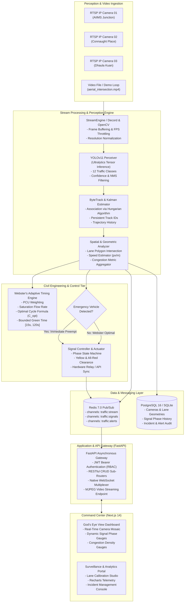
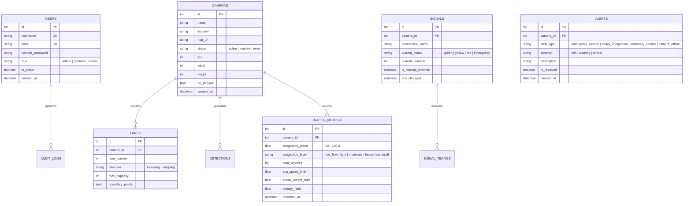

# System Architecture & Technical Design

## 1. Executive Summary

The **AI Smart Traffic Management System (TrafficAI)** is an enterprise-grade, real-time distributed platform designed for automated intersection monitoring, multi-camera vehicle surveillance, adaptive signal actuation, and incident detection.

The platform eliminates the latency, human error, and rigidity of conventional fixed-cycle traffic timers through an edge-accelerated perception and optimization loop:
- **Vision Layer**: High-framerate frame ingestion over RTSP/HLS and multi-class object detection using **YOLOv11** (12 discrete classes: cars, buses, trucks, motorcycles, auto-rickshaws, bicycles, pedestrians, ambulances, police cars, fire engines, debris, and barriers).
- **Spatial Tracking**: Multi-target state estimation with **ByteTrack** and Kalman filter motion prediction to maintain persistent Track IDs across occlusions and dense intersections.
- **Geometric Analytics**: Polygonal Region-of-Interest (ROI) lane zones, point-in-polygon ray-casting for per-lane queue counting, and perspective-calibrated velocity estimation.
- **Adaptive Optimization**: Civil-engineering-grade traffic signal timing dynamically calculated via **Webster's (1958) Optimal Cycle Equation** weighted by Passenger Car Units (**PCU**), featuring sub-second emergency vehicle preemption.
- **Distributed Pub/Sub & Telemetry**: Asynchronous message passing through **Redis 7**, streaming real-time JSON metrics and low-latency MJPEG feeds via native **FastAPI WebSockets**.
- **Mission Control GUI**: Next.js 14 App Router, React 18, Tailwind CSS, and Shadcn UI providing an operator command center ("God's Eye View") with interactive charts, live camera mosaics, and manual signal override controls.

---

## 2. High-Level Architecture Diagram



---

## 3. Real-Time Video Processing Pipeline

The video processing pipeline operates inside dedicated asynchronous worker threads per registered camera to isolate compute latency and prevent frame buffering:

```
[Camera RTSP Feed]
       │
       ▼ (10–30 FPS ingest)
[StreamEngine Frame Capture]
       │
       ▼ (Letterbox & Resize to 640x640)
[YOLOv11 Tensor Batch Inference] ──> Extracts [x1, y1, x2, y2, conf, class_id]
       │
       ▼ (High/Low confidence two-stage association)
[ByteTrack Multi-Object Tracker] ──> Assigns persistent Track IDs + Kalman state
       │
       ▼ (Cartesian centroids mapped to polygonal lane zones)
[Spatial Analytics Engine]
  ├── Lane Counting: Point-in-Polygon test (cv2.pointPolygonTest)
  ├── Speed Estimator: Euclidean displacement Δd / Δt * 3.6 km/h
  └── Congestion Engine: Weighted composite (Speed, Density, Queue, Occupancy)
       │
       ▼
[Webster Adaptive Timing Decision]
  ├── Emergency Preemption check (Ambulance / Fire / Police)
  └── Optimal Green Cycle calculated per phase
       │
       ▼
[Redis Pub/Sub & Persistence]
  ├── Broadcast to WebSocket listeners (telemetry JSON)
  ├── Yield MJPEG multipart frame for browser rendering
  └── Persist rolling window metrics to relational database
```

---

## 4. Webster's Adaptive Timing Mathematical Derivation

Traditional traffic controllers execute rigid fixed-time splits regardless of whether an approach is empty or clogged. TrafficAI implements **Webster's (1958) Optimal Cycle Formula** modified for heterogeneous mixed-vehicle traffic.

### Passenger Car Unit (PCU) Equivalencies
Different vehicles consume distinct spatial footprints and acceleration profiles:
$$\text{PCU}_{\text{total}} = \sum_{c \in \text{classes}} N_c \times W_c$$

| Vehicle Class | PCU Weight ($W_c$) | Rationale |
|---|---|---|
| **Car / Taxi** | 1.0 | Standard reference passenger vehicle |
| **Bus** | 3.0 | Large footprint, frequent stops, slow acceleration |
| **Truck** | 2.5 | Heavy commercial vehicle with extended braking distance |
| **Van** | 1.5 | Mid-size transport |
| **Auto-Rickshaw** | 0.8 | Compact three-wheeler, flexible maneuvers |
| **Motorcycle** | 0.5 | Highly compact, rapid acceleration |
| **Bicycle** | 0.3 | Slow, minimal road space |
| **Pedestrian** | 0.1 | Crosswalk occupancy factor |
| **Ambulance / Police / Fire** | **Preemption** | Bypasses cycle; forces emergency green phase |

### Optimal Cycle Length ($C_{\text{opt}}$)
$$C_{\text{opt}} = \frac{1.5 L + 5}{1 - \sum Y_i}$$

Where:
- $L$: Total lost time per cycle ($L = \sum (l_{\text{startup}} + l_{\text{clearance}})$), calibrated to $3.0\text{s}$ per phase.
- $Y_i$: Flow ratio of critical approach $i$ ($Y_i = \frac{q_i}{S_i}$), where $q_i$ is demand flow in PCU/hr and $S_i$ is saturation flow rate ($1800 \text{ PCU/hr/lane} \times \text{Lanes}$).

### Effective Green Allocation ($g_i$)
$$g_i = \frac{Y_i}{\sum Y} \times (C_{\text{opt}} - L)$$

Subject to strict safety and driver psychological limits:
$$15\text{s} \le g_i \le 120\text{s}$$

---

## 5. Database Schema & Data Models

The relational persistence tier (PostgreSQL in production, SQLite in local/test mode) maintains transactional integrity across system operations:



---

## 6. Concurrency Model & Hardware Acceleration

### Worker Thread Isolation
- Each camera operates a non-blocking `CameraWorker` maintaining an independent OpenCV `VideoCapture` buffer.
- Frame dropping guarantees that inference never lags behind real-world time: if an inference pass takes $32\text{ms}$, intermediate frames are discarded to prevent queue build-up.

### Hardware Acceleration Profiles
The inference engine auto-detects and binds to the optimal available acceleration backend:
1. **NVIDIA TensorRT / CUDA**: Sub-10ms inference per frame on RTX/A100 series GPUs.
2. **Apple Silicon Metal (MPS)**: Native acceleration on Apple M1/M2/M3 chips.
3. **Intel OpenVINO / CPU ONNX**: Multi-threaded vectorization via AVX-512/AVX2 on commodity CPU hosts.

---

## 7. Security & Role-Based Access Control (RBAC)

The system incorporates zero-trust principles for traffic critical infrastructure:

| Role | Permissions |
|---|---|
| **Admin** | Full system privileges: User registration, camera configuration, lane boundary editing, signal threshold overrides, audit log inspection. |
| **Operator** | Live operations: Manual signal preemption, trigger emergency clearance, acknowledge/resolve alerts, download telemetry reports. |
| **Viewer** | Read-only observation: View God's Eye Dashboard, inspect camera streams, analyze historical charts. |

- **Authentication**: JWT tokens signed with HMAC-SHA256 (`HS256`) with configurable expiration windows.
- **Passwords**: Salted hashing via `passlib[bcrypt]` with minimum work factor 12.
- **Transport Security**: TLS 1.3 termination via Nginx reverse proxy with HSTS, CSP headers, and rate limiting.
